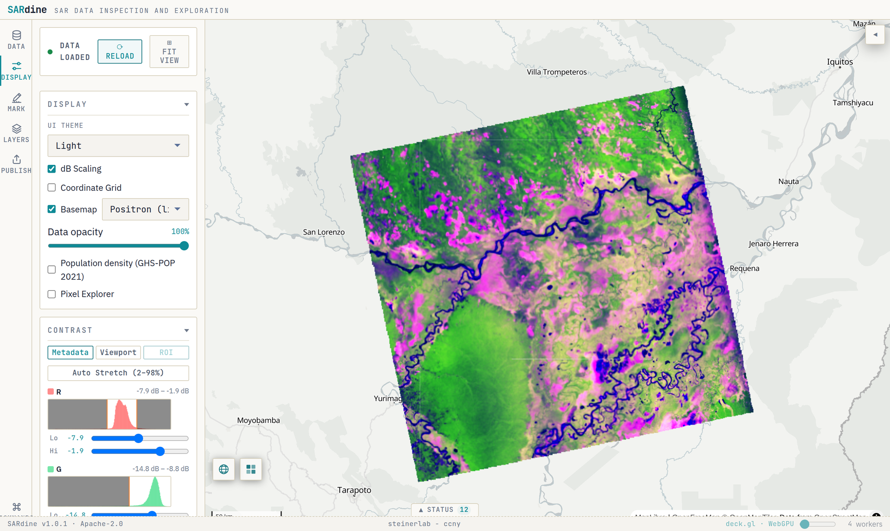

<div align="center">

<picture>
  <source media="(prefers-color-scheme: dark)" srcset="docs/sardine-logo.svg">
  <source media="(prefers-color-scheme: light)" srcset="docs/sardine-logo-light.svg">
  
</picture>

**SAR Data INspection and Exploration**

[](https://github.com/nicksteiner/sardine/actions/workflows/ci.yml)
[](https://github.com/nicksteiner/sardine/releases/latest)
[](LICENSE)
[](https://doi.org/10.5281/zenodo.23345870)

</div>

SARdine is a web application for viewing and exporting synthetic aperture radar (SAR) data. It reads NISAR Level-2 HDF5 products and Cloud Optimized GeoTIFFs directly in the browser using HTTP range requests or local file access, renders them on the GPU, and exports georeferenced GeoTIFFs and figures. It requires no server-side processing.

A hosted instance is available at <https://nicksteiner.github.io/sardine/>.

[](https://nicksteiner.github.io/sardine/?cog=https%3A%2F%2Fhuggingface.co%2Fdatasets%2Fnicksteiner%2Fsardine-demo-data%2Fresolve%2Fmain%2Fpacaya_full_hh.tif,https%3A%2F%2Fhuggingface.co%2Fdatasets%2Fnicksteiner%2Fsardine-demo-data%2Fresolve%2Fmain%2Fpacaya_full_hv.tif&comp=dual-pol-h&mode=rgb&db=1&stretch=sigmoid)

*Figure 1. NISAR L-band GCOV (frequency A, 20 m), Pacaya-Samiria National Reserve, Peru, shown over an OpenStreetMap basemap. R = HH, G = HV, B = HH/HV, in dB with a sigmoid stretch. The source is a pair of Cloud Optimized GeoTIFFs (about 1 GB). Click the image to open this scene in the hosted instance.*

## Background

NISAR Level-2 GCOV and GUNW granules are 2 to 8 GB HDF5 files. Inspecting one usually means downloading the full granule and opening it in a GIS or Python environment, even when only a small area is of interest. SARdine includes an HDF5 reader written in JavaScript (`h5chunk`) that reads the file metadata once (about 1 to 8 MB) and then fetches only the compressed chunks that intersect the current view or region of interest. The same code path is used for local files, presigned S3 URLs and NASA DAAC archives.

SARdine is intended for quality assessment of SAR products, exploratory analysis of backscatter and polarimetric signatures, figure preparation, and subsetting regions of interest for further processing in other software.

## Supported data

| Format | Access | Notes |
|:---|:---|:---|
| NISAR L2 GCOV (HDF5) | local file, HTTPS, S3 presigned URL, NASA CMR search | Frequencies A and B; all covariance terms (HHHH, HVHV, VVVV, ...) |
| NISAR L2 GUNW (HDF5) | local file, HTTPS | Unwrapped phase, coherence, connected components; experimental |
| Cloud Optimized GeoTIFF | local file, HTTPS | Single- and multi-band; uses internal overviews; honours GDAL nodata |
| GDAL VRT | HTTPS | Mosaics and band stacks over COG sources |
| NITF / SICD | local file, HTTPS | Complex SLC, displayed as magnitude |
| GeoJSON | local file | Vector overlays and saved annotations |

Sentinel-1 and OPERA products distributed as COGs use the COG reader. Reading from NASA DAACs requires an Earthdata Login token (see [Data access](#data-access)).

## Methods

Radiometric operations are applied to linear power (σ⁰ or γ⁰, as provided by the product) in GLSL fragment shaders. Exports use a CPU implementation of the same operations.

**Decibels.** x<sub>dB</sub> = 10 log<sub>10</sub>(max(x, 10⁻¹⁰)), so zero power maps to −100 dB.

**Nodata.** Values of 0 or NaN are nodata and are drawn transparent. In a colour composite a pixel is transparent only when all three channels are nodata.

**Multilooking.** Exports use an *n* × *n* box average in linear power. An output pixel is nodata if fewer than half of its *n*² input pixels are valid. The on-screen view subsamples chunks instead, so rendered (not raw) exports apply an additional 3 × 3 smoothing to approximate the displayed texture.

**Contrast.** Values are scaled to [0, 1] between limits *a* and *b* (by default the 2nd and 98th percentiles of the visible data), then passed through one of the following:

| Mode | f(v) |
|:---|:---|
| linear | v |
| sqrt | √v |
| gamma | v<sup>γ</sup> |
| sigmoid | 1 / (1 + e<sup>−8γ(v − 0.5)</sup>), rescaled so that f(0) = 0 and f(1) = 1 |

Histograms and statistics are computed with WebGPU compute shaders where available and on the CPU otherwise.

**Colour composites.** Channels are computed from linear power before conversion to dB. Each channel has its own contrast limits.

| Preset | R | G | B |
|:---|:---|:---|:---|
| `hh-hv-vv` | HH | HV | VV |
| `dual-pol-h` | HH | HV | HH / max(HV, 10⁻¹⁰) |
| `dual-pol-v` | VV | VH | VV / max(VH, 10⁻¹⁰) |
| `multi-temporal` | date 1 | date 2 | date 3 |

Pauli and Freeman-Durden composites are present in the code but disabled, because the current implementations use power terms only and do not match the published decompositions.

**Radar Vegetation Index.** RVI = 8 HV / (HH + VV + 2 HV) for quad-pol data (Kim and van Zyl, 2009) and 4 HV / (HH + HV) for dual-pol data.

**Speckle filters.** Boxcar, Lee (1980) and enhanced Lee filters, implemented as WebGPU compute shaders with a WebGL2 fallback.

**Geolocation and measurement.** NISAR products are georeferenced from their coordinate datasets and COGs from their GeoTIFF keys. Data can be displayed in the native grid or reprojected onto a Web Mercator basemap. Distances use the haversine formula on a spherical Earth after transforming coordinates with proj4. Areas are reported in km².

**Classification.** Pixels in a region of interest can be classified by drawing class boxes on a two-dimensional histogram of two channels (for example HH and HV in dB). NISAR data can also be filtered by incidence angle.

**Models.** Pixel classifiers packaged as a JSON manifest with ONNX weights run in the browser with ONNX Runtime Web. The included river ice / open water U-Net for L-band data is described, with its known limitations, in [docs/RIVER_ICE_MODEL.md](docs/RIVER_ICE_MODEL.md).

## Outputs

| Output | Content |
|:---|:---|
| GeoTIFF (raw) | Float32 linear power with CRS and tie points; optional subset and multilook |
| GeoTIFF (rendered) | RGBA image as displayed |
| Figure (PNG, SVG) | Image with scale bar, coordinates, colour bar or ternary key, and annotations |
| Plots (SVG) | Histograms, two-channel scatter plots, transect profiles, time series |
| Annotations (GeoJSON) | Points, boxes, lines and class regions with observer, method, time stamp and region statistics |

Each GeoTIFF export is accompanied by a JSON file (`{name}.tif.json`). It records the source product, display settings, processing parameters and software version. The display state can also be stored in a URL ([docs/DEEP_LINKS.md](docs/DEEP_LINKS.md)), so a figure can be regenerated from its link.

## Data access

Local files are read in the browser and are not uploaded. Files on servers that allow cross-origin requests (for example Hugging Face, the Capella and Umbra open data programs, or S3 buckets with CORS enabled) can be opened by URL.

The proposal's products are plain Cloud Optimized GeoTIFFs and need no proxy: they open directly by URL, without an Earthdata token. The rest of this section applies only to NASA DAAC archives.

NASA DAACs do not allow cross-origin requests, so the hosted instance sends DAAC requests through a small Cloudflare Worker ([`sardine-edl-proxy/`](sardine-edl-proxy/)). The worker adds the required headers and forwards the user's Earthdata Login token.

- The token is stored in the browser and sent only to the worker and to NASA hosts, in a request header. The worker accepts only NASA host names, removes the token if a request is redirected elsewhere, and does not log or store tokens.
- Users can run their own copy of the worker (`cd sardine-edl-proxy && npx wrangler deploy`) and enter its URL in the Earthdata panel.
- Earthdata tokens give read-only access to data and can be [revoked](https://urs.earthdata.nasa.gov/user_tokens) at any time.
- The local development server (`npm run dev`) handles DAAC requests itself, without the worker.

## Installation

The hosted instance needs no installation. It requires a browser with WebGL2 (current versions of Chrome, Edge, Firefox or Safari); WebGPU is used if available.

To run locally (Node.js 18 or later):

```bash
git clone https://github.com/nicksteiner/sardine.git
cd sardine
npm install
npm run dev          # http://localhost:5173
```

Server mode, for JupyterHub or other shared environments, adds a file browser, a STAC catalogue (DuckDB) and S3 URL signing:

```bash
npm install && npm run build
node server/launch.cjs --data-dir /path/to/data    # serves on port 8050
```

## Usage

Drag a `.h5`, `.tif`, NITF or `.geojson` file onto the page, or paste a URL. For HDF5 products, choose the frequency and polarization or a composite preset. The data source and display settings can be given in the URL:

```text
?url=<.h5 or .tif URL>&db=1&min=-16&max=2&cmap=viridis       # source and display settings
?url=<URL>&bbox=-77.48,38.90,-77.26,39.01                     # limit reading to a region
?bbox=-74.26,40.49,-73.70,40.92&t=2025-12-01/2025-12-31       # find a NISAR granule by region and date (CMR)
```

Tutorials for colour composites, classification and time series, and a list of controls and keyboard shortcuts, are in [docs/TUTORIALS.md](docs/TUTORIALS.md). An example session using ASF DAAC data is in [docs/DEMO.md](docs/DEMO.md).

## Implementation

```
file or URL → h5chunk / geotiff.js → decompression (Web Workers, IndexedDB cache) → float texture
                                                                                         ↓
                 screen or export ← colour map ← stretch ← scaling ← dB (GLSL shaders)
```

`h5chunk` reads HDF5 superblock versions 0 to 3, including paged files, and v1 B-tree, fixed-array and single-chunk indexes. It supports deflate and shuffle filters and 16-, 32- and 64-bit floating point data. Chunks are decompressed in a pool of Web Workers, and recently used chunks are kept in an IndexedDB cache (about 200 MB). Rendering uses deck.gl 9 and luma.gl 9 on WebGL2. Other dependencies are React, geotiff.js, @developmentseed/geotiff, h5wasm, MapLibre GL, proj4 and ONNX Runtime Web.

Further detail: [docs/CLOUD_OPTIMIZED_HDF5.md](docs/CLOUD_OPTIMIZED_HDF5.md), [docs/CHUNK_PIPELINE.md](docs/CHUNK_PIPELINE.md), [docs/HDF5_FILE_FORMAT.md](docs/HDF5_FILE_FORMAT.md).

## Testing

`npm test` runs on every commit through [GitHub Actions](https://github.com/nicksteiner/sardine/actions/workflows/ci.yml). It includes GeoTIFF write and read-back tests, `h5chunk` tests on synthetic HDF5 files, and tests of the statistics, dB conversion, region-to-pixel conversion, URL parameters, export metadata and CPU fallbacks. `npm run test:model` runs the river ice model in a headless browser on NISAR image tiles and compares the output with reference labels.

## Known limitations

- Frequency A GCOV products have no HDF5 overviews, so displaying a full frequency A frame is slow. Use a region (`bbox`) or frequency B for an overview.
- Georeferencing at coarse COG overview levels can be off by up to one overview pixel.
- Faint lines can appear along tile boundaries in colour composites.
- GUNW support is experimental. Pauli and Freeman-Durden composites are disabled.
- The river ice model is valid only on river channels at full resolution and does not predict the mixed ice/water class.

## Citation

Please cite the version of SARdine you used. Each release is archived on Zenodo; [10.5281/zenodo.23345870](https://doi.org/10.5281/zenodo.23345870) refers to all versions and resolves to the latest. Citation metadata is in [CITATION.cff](CITATION.cff).

> Steiner, N. C. (2026). SARdine: browser-native SAR data inspection and exploration (Version 1.0.2) [Computer software]. Zenodo. https://doi.org/10.5281/zenodo.23354632

## Contributing

Report problems and requests through [GitHub Issues](https://github.com/nicksteiner/sardine/issues). See [docs/CONTRIBUTING.md](docs/CONTRIBUTING.md) and [docs/CHANGELOG.md](docs/CHANGELOG.md).

## License

Copyright 2026 Nicholas C. Steiner, The City College of New York. SARdine is released under the [Apache License 2.0](LICENSE). The river ice model weights, hosted on [Hugging Face](https://huggingface.co/datasets/nicksteiner/sardine-demo-data), are released under CC-BY-4.0.

## Acknowledgements

SARdine uses [h5wasm](https://github.com/usnistgov/h5wasm), [geotiff.js](https://geotiffjs.github.io/), [deck.gl](https://deck.gl/), [MapLibre](https://maplibre.org/) and [ONNX Runtime](https://onnxruntime.ai/). Guidance on cloud-optimized NISAR HDF5 was provided by NSIDC and JPL.

## References

Freeman, A., and Durden, S. L. (1998). A three-component scattering model for polarimetric SAR data. *IEEE Transactions on Geoscience and Remote Sensing*, 36(3), 963–973.

Kim, Y., and van Zyl, J. J. (2009). A time-series approach to estimate soil moisture using polarimetric radar data. *IEEE Transactions on Geoscience and Remote Sensing*, 47(8), 2519–2527.

Lee, J.-S. (1980). Digital image enhancement and noise filtering by use of local statistics. *IEEE Transactions on Pattern Analysis and Machine Intelligence*, 2(2), 165–168.
